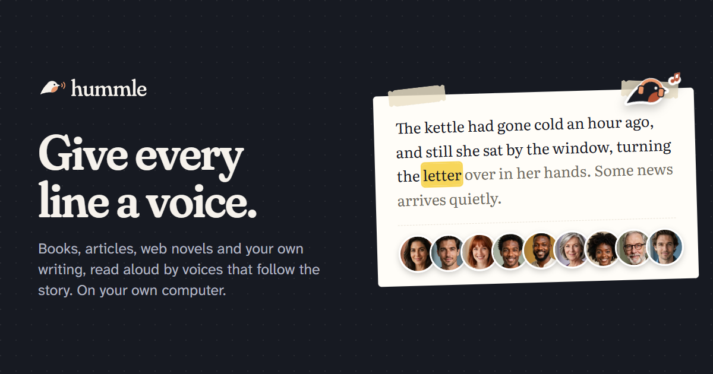
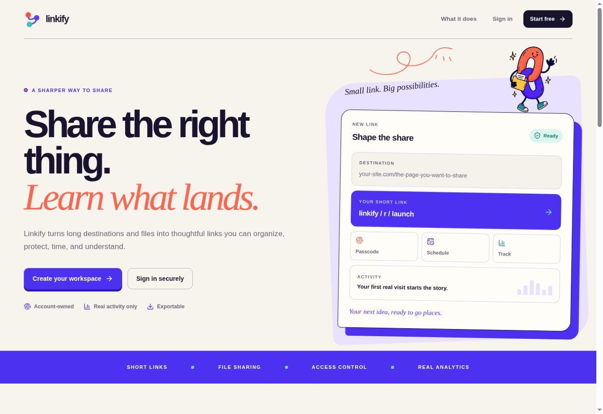
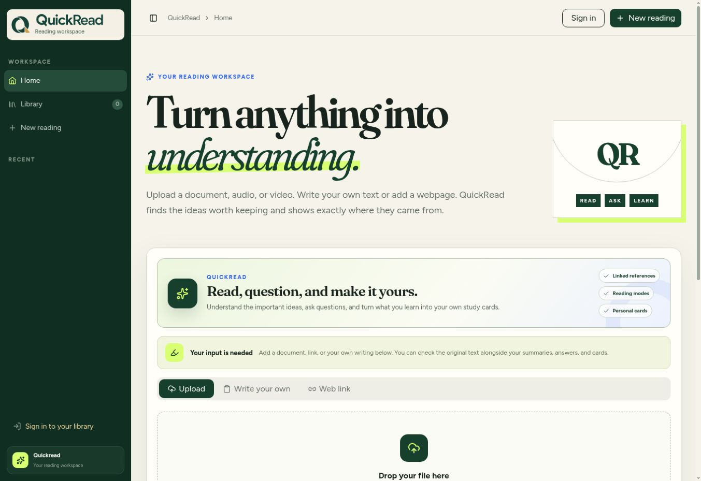
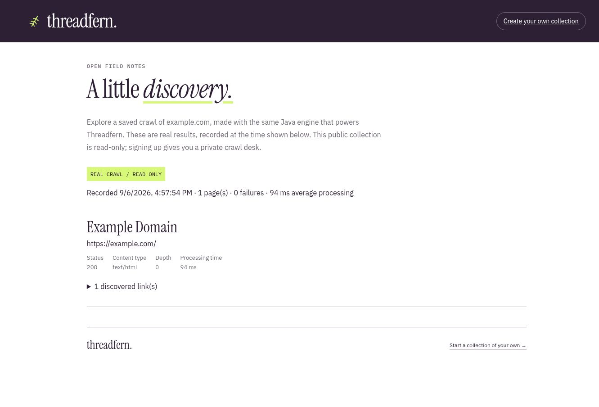
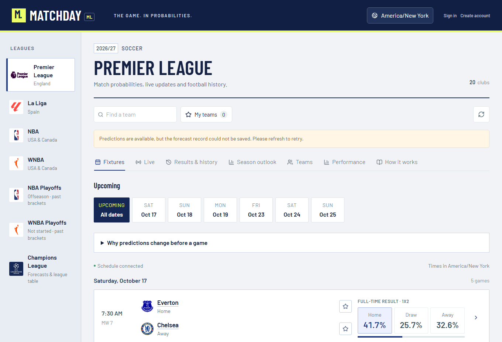
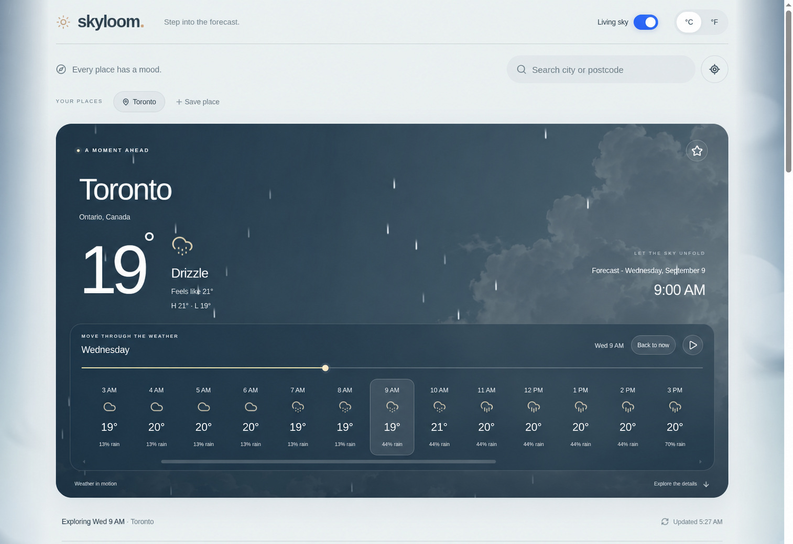
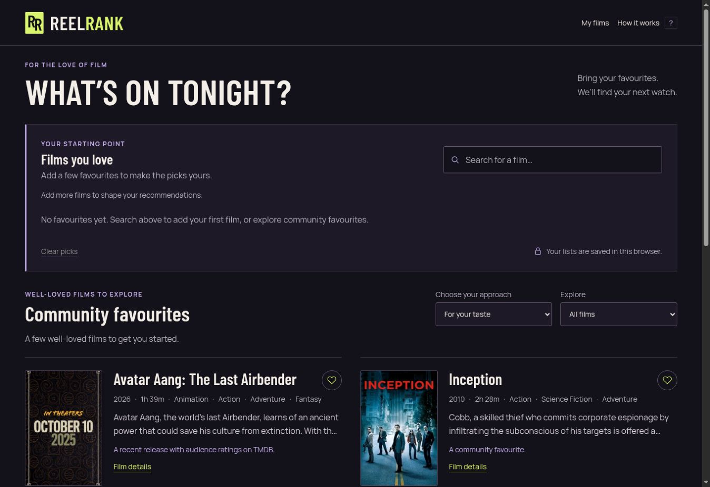

  

  <a href="https://geraldikem.com/"><strong>Website</strong></a> &nbsp; · &nbsp;
  <a href="https://geraldikem.com/resume/Gerald_Ikem_Resume.pdf"><strong>Résumé</strong></a> &nbsp; · &nbsp;
  <a href="https://www.linkedin.com/in/gerald-ikem-158926233/"><strong>LinkedIn</strong></a> &nbsp; · &nbsp;
  <a href="mailto:geraldikem15@gmail.com"><strong>Email me</strong></a> &nbsp; · &nbsp;
  <a href="#explore-the-projects"><strong>Explore the projects</strong></a>

**Hi, I'm Gerald Ikem; a backend engineer based in Toronto.** At **Payaza**, I build Java and Spring Boot services for payments, merchant onboarding, foreign-exchange rates, and back-office security. I also develop and maintain campaign websites for **Believer's LoveWorld**.

I'm studying part-time for a **Master of Computer Science at the University of Illinois Urbana-Champaign**, starting with Applied Machine Learning, after a Computer Science degree from **York University**. My interests span **backend engineering, data science, and applied machine learning**. These projects bring those interests into apps people can explore and use. The full write-ups, with what was hard and how I fixed it, are on **[geraldikem.com](https://geraldikem.com/)**.

## Now building

<table>
<tr>
<td width="50%" valign="top">

</td>
<td width="50%" valign="top">

### Hummle &nbsp; `in progress`
**Give every line a voice.**

A private read-aloud app for your own PC. Hummle will read your drafts, web pages, and long web novels aloud in expressive, consistent voices, with nothing sent to the cloud. Right now I'm proving the voice engine: every model runs faster than real time on one GPU, and each take is checked by code for word accuracy, voice identity, and accent.

**Stack:** `Python` `whisper.cpp` `GGUF on Vulkan` `PyTorch on ROCm` `librosa`

**[Follow Hummle](https://hummle.app/)**

</td>
</tr>
</table>

## Explore the projects

<table>
<tr>
<td width="50%" valign="top">

### 01 / Linkify
**One place for everything you share.**

Create memorable short links, share files up to 1 GB, and bring your links together on a personal page. Add custom QR codes, set expiry dates or passcodes, and see how people discover what you've shared. The core is being rewritten in Java 21 and Spring Boot 4, with 244 tests run against real Postgres and Redis.

**Stack:** `Java` `Spring Boot` `PostgreSQL` `Redis` `Next.js` `TypeScript` `Amazon S3`

**[Visit Linkify](https://uselinkify.com/)**

</td>
<td width="50%" valign="top">

### 02 / QuickRead
**Turn a long read into lasting understanding.**

Bring in documents, webpages, or recordings. Explore summaries at different depths, ask questions with references to the original text, and turn useful ideas into editable study cards and notes.

**Stack:** `Python` `Pyodide` `React` `Next.js` `TypeScript` `Cloudflare Workers`

**[Open QuickRead](https://usequickread.com/)**

</td>
</tr>
<tr>
<td width="50%" valign="top">

### 03 / Threadfern
**Follow the links. Keep the discoveries.**

Crawl a website and collect its page titles, URLs, status codes, and discovered links. Search your collections, inspect broken links, revisit previous runs, and export the results. The public example lets you look around immediately.

**Stack:** `Java 17` `JDBC` `PostgreSQL` `Node.js` `Docker`

**[Explore the demo](https://threadfern.dev/demo)** · [Start a collection](https://threadfern.dev/)

</td>
<td width="50%" valign="top">

### 04 / Matchday ML
**See the game through the numbers.**

Explore Premier League, La Liga, NBA, and WNBA predictions. Every forecast is frozen at kickoff, so you can compare what the model said before a game with what actually happened. On 1,140 held-out Premier League games it picks 53.4% correctly, against 43.2% for a baseline.

**Stack:** `Python` `scikit-learn` `CatBoost` `Next.js` `TypeScript` `SQLite`

**[Matchday ML website](https://matchdayml.com/)**

</td>
</tr>
<tr>
<td width="50%" valign="top">

### 05 / Skyloom
**Step into the forecast.**

Explore the weather with a sky that changes alongside the forecast. Move through hourly conditions, check the days ahead, inspect rain and wind charts, follow daylight and moon phases, and save places you care about.

**Stack:** `React` `TypeScript` `Three.js` `React Three Fiber` `Cloudflare Workers`

**[Explore Skyloom](https://skyloom.app/)**

</td>
<td width="50%" valign="top">

### 06 / ReelRank
**Your next film starts with your favorites.**

Discover films shaped by what you like. Compare recommendation approaches, explore film details, build a watchlist, and hide titles you've watched or aren't interested in. Recommendations change as your preferences do.

**Stack:** `Python` `scikit-learn` `pandas` `NumPy` `SciPy` `JavaScript`

**[Find your next film](https://www.reelrank.dev/)**

</td>
</tr>
</table>

---

  <strong>Found something interesting? I'd love to hear what you think.</strong> 
  <a href="mailto:geraldikem15@gmail.com">geraldikem15@gmail.com</a> &nbsp; · &nbsp;
  <a href="https://www.linkedin.com/in/gerald-ikem-158926233/">Connect on LinkedIn</a> &nbsp; · &nbsp;
  <a href="https://geraldikem.com/">geraldikem.com</a>

